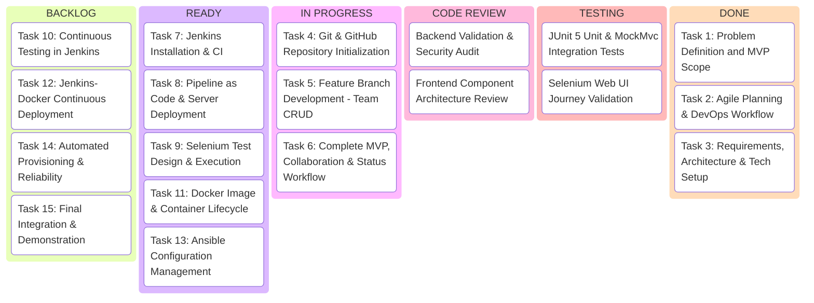

# Agile Task Board (Kanban Workflow)

**Workflow Columns:**  
`BACKLOG` → `READY` → `IN PROGRESS` → `CODE REVIEW` → `TESTING` → `DONE`

---

## Current Kanban Board State

---

## Detailed Task Matrix

| Task ID | Title | Owner | Column | Verification Method |
| :--- | :--- | :--- | :--- | :--- |
| **TSK-01** | Problem Statement & Scope | Product Architect | DONE | Approved markdown in `docs/requirements/` |
| **TSK-02** | Agile Planning & Lifecycles | Scrum Master | DONE | Backlog, Board, Sprint Plan, DoD in `docs/agile/` |
| **TSK-03** | Requirements, Architecture & API | Software Architect | DONE | SRS, Architecture & API specifications in `docs/` |
| **TSK-04** | Git & GitHub Setup | DevOps Engineer | IN PROGRESS | Repo initialized, branches, templates, .gitignore |
| **TSK-05** | Team Registration & Listing | Full-Stack Dev | IN PROGRESS | Entity, Repository, Service, API, and UI components |
| **TSK-06** | Complete MVP & Status Workflow | Full-Stack Dev | IN PROGRESS | Member management, RBAC, Status machine, Dashboard |
| **TSK-07** | Jenkins CI Setup | DevOps Engineer | READY | Jenkinsfile with checkout, compile, test, package stages |
| **TSK-08** | Pipeline as Code & Deployment | DevOps Engineer | READY | Jenkins stages, Nginx reverse proxy configurations |
| **TSK-09** | Selenium WebDriver Automation | QA Engineer | READY | 5 critical user journeys with screenshots |
| **TSK-10** | Continuous Testing in Jenkins | QA / DevOps | BACKLOG | Pipeline integration, test failure simulation & fix |
| **TSK-11** | Docker Containerization | DevOps Engineer | READY | Multi-stage Dockerfile, docker-compose.yml |
| **TSK-12** | Jenkins-Docker CD & Rollback | DevOps Engineer | BACKLOG | Automated build, tag, health check, rollback logic |
| **TSK-13** | Ansible Configuration Management | DevOps Engineer | READY | Playbook, inventory, idempotent roles & templates |
| **TSK-14** | Automated Provisioning & Recovery | DevOps Engineer | BACKLOG | Idempotency verification and recovery validation |
| **TSK-15** | Final Project Report & Demo | All Roles | BACKLOG | Final report, demonstration script, evidence log |
