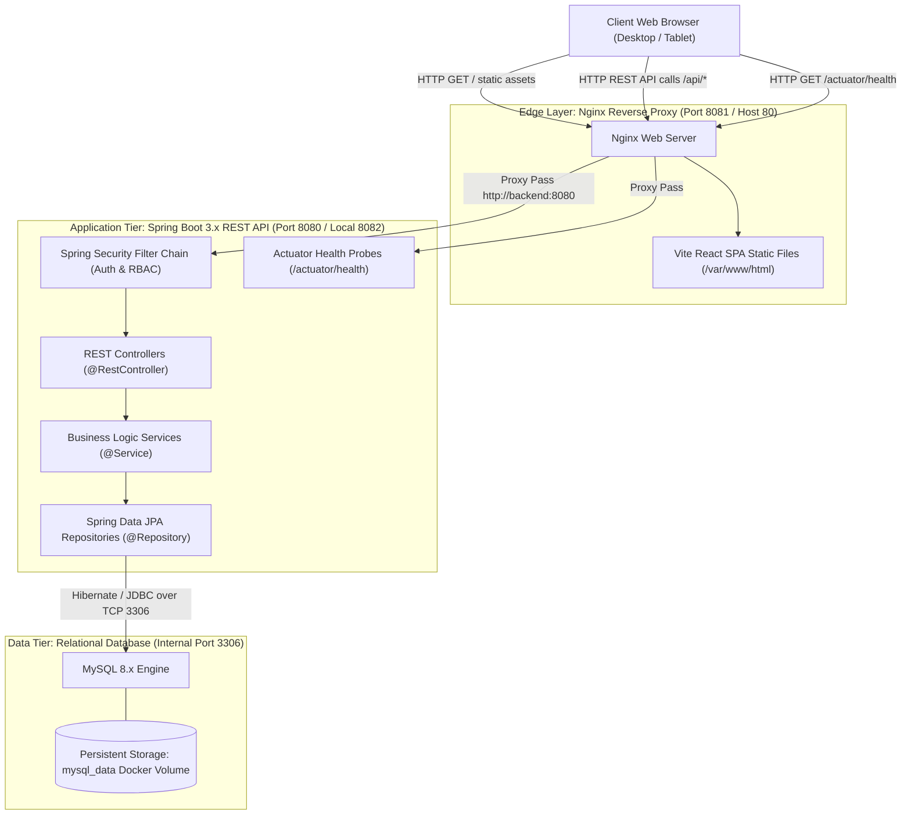

# Application Architecture

**Project:** Dockerized Hackathon Team Management System  
**Pattern:** Multi-Tiered Layered Architecture with Reverse Proxy & Database Persistence  

---

## 1. High-Level Architecture Overview

The system architecture cleanly separates presentation, business logic, data persistence, and reverse proxy layers:

---

## 2. Component Responsibilities

### 2.1 Frontend Component (React + Vite)
* **Framework:** React 18, Vite bundling, Vanilla CSS design system with custom CSS variables, dark/light sleek dashboard palette.
* **Routing:** `react-router-dom` with client-side protected routes based on authenticated role.
* **State Management & Network:** React Context API (`AuthContext`) paired with a centralized Axios client (`apiClient.js`) configuring base URLs, JSON headers, and HTTP interceptors for error handling.
* **Visualizations:** `recharts` responsive bar charts and pie charts for real-time track and status breakdowns.

### 2.2 Reverse Proxy & Static Server (Nginx)
* **Role:** Single point of entry for containerized deployments.
* **Functions:**
  - Serves compiled static frontend assets with caching and compression.
  - Proxies `/api/` requests to `http://backend:8080/api/`.
  - Proxies `/actuator/` health endpoints to `http://backend:8080/actuator/`.
  - Enforces same-origin policy, eliminating CORS overhead in production.

### 2.3 Backend REST API (Spring Boot 3.x / Java 21)
* **Web Layer:** Spring Web `@RestController` implementing RESTful guidelines, pagination, sorting, and centralized `@ControllerAdvice` error mapping.
* **Security Layer:** Spring Security 6 with `BCryptPasswordEncoder`, stateless session/cookie management, and method-level security (`@PreAuthorize`).
* **Service Layer:** Transactional services (`@Transactional`) implementing business logic, state-machine transitions, and aggregation routines.
* **Persistence Layer:** Spring Data JPA with Hibernate, optimistic locking, and dynamic criteria search queries.

### 2.4 Database Tier (MySQL 8.x)
* **Schema Management:** Automated table creation and schema validation via Hibernate DDL.
* **Data Persistence:** Dedicated named Docker volume (`mysql_data`) mounted to `/var/lib/mysql` to preserve records across container restarts and redeployments.
* **Testing Isolation:** In-memory H2 database engine utilized exclusively during automated Maven tests (`test` profile) to prevent altering development data.

---

## 3. Development vs Production Port Mapping

| Service | Development Mode | Production Docker Mode |
| :--- | :--- | :--- |
| **Frontend UI** | `http://localhost:5173` (Vite dev server) | `http://localhost:8081` (Nginx entry point) |
| **Spring Boot Backend** | `http://localhost:8082` (Avoids Jenkins on 8080) | Internal Docker network `backend:8080` |
| **MySQL Database** | Internal / Local `localhost:3306` | Internal Docker network `db:3306` (unexposed to host) |
| **Jenkins Controller** | Active on `http://localhost:8080` | Host port `8080` (or dedicated container) |
| **Health Probe** | `http://localhost:8082/actuator/health` | `http://localhost:8081/actuator/health` |
