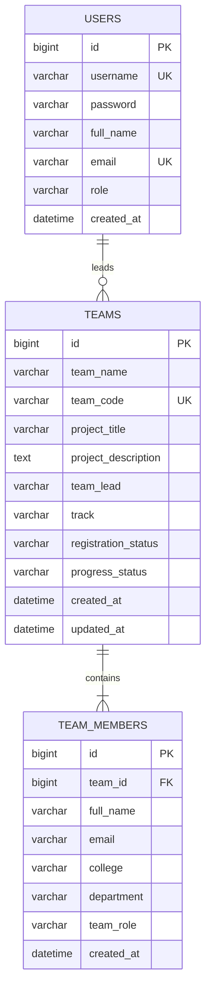

# Data Model & Schema Specification

**Project:** Dockerized Hackathon Team Management System  
**Engine:** MySQL 8.x / Spring Data JPA  

---

## 1. Entity-Relationship Diagram (ERD)

---

## 2. Table Schemas & Constraints

### 2.1 Table: `users`
* `id` BIGINT AUTO_INCREMENT PRIMARY KEY
* `username` VARCHAR(50) NOT NULL UNIQUE
* `password` VARCHAR(255) NOT NULL (BCrypt hashed string)
* `full_name` VARCHAR(100) NOT NULL
* `email` VARCHAR(100) NOT NULL UNIQUE
* `role` ENUM('ADMIN', 'ORGANIZER', 'TEAM_LEAD') NOT NULL
* `created_at` DATETIME NOT NULL DEFAULT CURRENT_TIMESTAMP

### 2.2 Table: `teams`
* `id` BIGINT AUTO_INCREMENT PRIMARY KEY
* `team_name` VARCHAR(100) NOT NULL
* `team_code` VARCHAR(30) NOT NULL UNIQUE (e.g. `HTM-2026-AI01`)
* `project_title` VARCHAR(200) NOT NULL
* `project_description` TEXT NOT NULL
* `team_lead` VARCHAR(100) NOT NULL
* `track` ENUM('AI_ML', 'WEB3_BLOCKCHAIN', 'FINTECH', 'HEALTHTECH', 'OPEN_INNOVATION', 'CYBERSECURITY') NOT NULL
* `registration_status` ENUM('DRAFT', 'REGISTERED', 'APPROVED', 'IN_PROGRESS', 'SUBMITTED', 'COMPLETED', 'REJECTED') NOT NULL DEFAULT 'REGISTERED'
* `progress_status` ENUM('NOT_STARTED', 'IN_DESIGN', 'IN_DEVELOPMENT', 'CODE_FREEZE', 'TESTED', 'SUBMITTED') NOT NULL DEFAULT 'NOT_STARTED'
* `created_at` DATETIME NOT NULL DEFAULT CURRENT_TIMESTAMP
* `updated_at` DATETIME NOT NULL DEFAULT CURRENT_TIMESTAMP ON UPDATE CURRENT_TIMESTAMP

### 2.3 Table: `team_members`
* `id` BIGINT AUTO_INCREMENT PRIMARY KEY
* `team_id` BIGINT NOT NULL, FOREIGN KEY (`team_id`) REFERENCES `teams`(`id`) ON DELETE CASCADE
* `full_name` VARCHAR(100) NOT NULL
* `email` VARCHAR(100) NOT NULL
* `college` VARCHAR(150) NOT NULL
* `department` VARCHAR(100) NOT NULL
* `team_role` ENUM('FRONTEND', 'BACKEND', 'FULLSTACK', 'UI_UX', 'DATA_SCIENTIST', 'DEVOPS') NOT NULL
* `created_at` DATETIME NOT NULL DEFAULT CURRENT_TIMESTAMP
* **Composite Constraint:** Unique index on (`team_id`, `email`) prevents duplicate member email entries in the same team.

---

## 3. Seed Accounts & Defaults
| Username | Role | Purpose | Default Password |
| :--- | :--- | :--- | :--- |
| `admin` | `ADMIN` | System administrator & master evaluator | `Admin@123` |
| `organizer` | `ORGANIZER` | Event manager & track coordinator | `Organizer@123` |
| `teamlead` | `TEAM_LEAD` | Team participant lead | `Lead@123` |

*Note:* Passwords in database storage are hashed with BCrypt. Plaintext credentials are never committed or logged.
