# Use Case Model & Specification

**Project:** Dockerized Hackathon Team Management System  
**Version:** 1.0.0  

---

## 1. System Use Case Diagram

```mermaid
flowchart TD
    subgraph Actors
        Admin((Admin))
        Organizer((Organizer))
        TeamLead((Team Lead))
    end

    subgraph Authentication_Boundary ["Authentication"]
        UC_Login["Log In with Credentials"]
        UC_Logout["Log Out & Invalidate Session"]
        UC_Me["Check Current User Role"]
    end

    subgraph Team_Management_Boundary ["Team Operations"]
        UC_CreateTeam["Create Team"]
        UC_ViewTeams["List & Search Teams"]
        UC_ViewTeamDetails["View Team Details"]
        UC_UpdateTeam["Update Team Information"]
        UC_DeleteTeam["Delete Team"]
        UC_TransitionStatus["Transition Team Status"]
    end

    subgraph Member_Management_Boundary ["Member Operations"]
        UC_AddMember["Add Team Member"]
        UC_UpdateMember["Update Team Member"]
        UC_RemoveMember["Remove Team Member"]
    end

    subgraph Analytics_Boundary ["Analytics & Health"]
        UC_Dashboard["View Dashboard & Charts"]
        UC_Health["Check System Health"]
    end

    %% Actor Relationships
    Admin --> UC_Login
    Admin --> UC_Logout
    Admin --> UC_Me
    Admin --> UC_CreateTeam
    Admin --> UC_ViewTeams
    Admin --> UC_ViewTeamDetails
    Admin --> UC_UpdateTeam
    Admin --> UC_DeleteTeam
    Admin --> UC_TransitionStatus
    Admin --> UC_AddMember
    Admin --> UC_UpdateMember
    Admin --> UC_RemoveMember
    Admin --> UC_Dashboard
    Admin --> UC_Health

    Organizer --> UC_Login
    Organizer --> UC_Logout
    Organizer --> UC_Me
    Organizer --> UC_CreateTeam
    Organizer --> UC_ViewTeams
    Organizer --> UC_ViewTeamDetails
    Organizer --> UC_UpdateTeam
    Organizer --> UC_TransitionStatus
    Organizer --> UC_AddMember
    Organizer --> UC_UpdateMember
    Organizer --> UC_RemoveMember
    Organizer --> UC_Dashboard
    Organizer --> UC_Health

    TeamLead --> UC_Login
    TeamLead --> UC_Logout
    TeamLead --> UC_Me
    TeamLead --> UC_ViewTeams
    TeamLead --> UC_ViewTeamDetails
    TeamLead --> UC_UpdateTeam
    TeamLead --> UC_AddMember
    TeamLead --> UC_RemoveMember
    TeamLead --> UC_Dashboard
    TeamLead --> UC_Health
```

---

## 2. Core Use Case Specifications

### UC-1: Transition Team Status
* **Primary Actor:** Organizer or Admin (Team Lead for initial submit)
* **Preconditions:** Team exists and user is authenticated with permitted role.
* **Main Success Scenario:**
  1. User navigates to team details and selects next permitted status (e.g. `REGISTERED` -> `APPROVED`).
  2. System validates that current status transition is permissible under workflow rules.
  3. System verifies user role permissions for the specific target state.
  4. System updates team status, sets `updatedAt` to current UTC timestamp, and returns updated team payload.
* **Exception Scenario:**
  - If user selects an invalid transition (e.g. `DRAFT` to `COMPLETED`), system returns HTTP 400 Bad Request with explanation: `"Invalid status transition from DRAFT to COMPLETED"`.
  - If a Team Lead tries to execute an `APPROVED` or `REJECTED` transition, system returns HTTP 403 Forbidden.

### UC-2: Add Team Member
* **Primary Actor:** Team Lead, Organizer, or Admin
* **Preconditions:** Team exists in the database.
* **Main Success Scenario:**
  1. Actor submits member full name, valid email address, college, department, and team role.
  2. System validates all field constraints and checks for duplicate email inside this team.
  3. System persists member entity linked to team and updates derived member count.
  4. System returns HTTP 201 Created with the saved member details.
* **Exception Scenario:**
  - Duplicate email inside team returns HTTP 409 Conflict.
  - Invalid email syntax returns HTTP 400 Bad Request.
