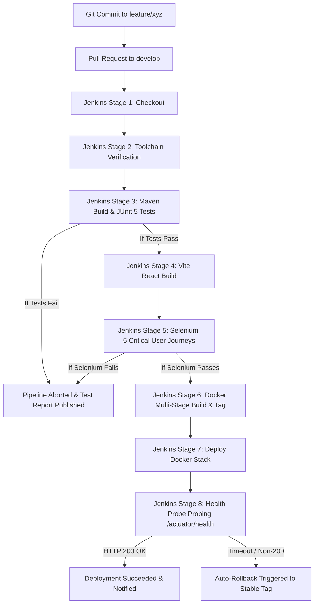

# CI/CD Pipeline & Automation Workflow

**Project:** Dockerized Hackathon Team Management System  
**Pipeline Orchestrator:** Jenkins Declarative Pipeline  

---

## 1. Overview
The continuous integration and continuous deployment (CI/CD) engine orchestrates the transformation of developer commits into tested, containerized releases deployed behind an Nginx reverse proxy.

---

## 2. Pipeline Stages in Detail

### Stage 1: Checkout Source
* Clones Git repository using Jenkins SCM credentials.
* Resolves branch (`main`, `develop`, or PR ref).

### Stage 2: Environment Verification
* Verifies presence of JDK 21 (`java -version`), Maven 3.9+ (`mvn -version`), and Node.js 22 (`node -v`).

### Stage 3: Backend Build & Unit/Integration Tests
* Runs `mvn clean verify --batch-mode` inside `backend/`.
* Executes 13 JUnit 5 unit and MockMvc integration tests using an isolated in-memory H2 database.
* Publishes test results via Jenkins `junit` step to `backend/target/surefire-reports/*.xml`.

### Stage 4: Frontend Compilation
* Runs `npm ci` and `npm run build` inside `frontend/`.
* Bundles static JavaScript, CSS, and HTML assets into `frontend/dist/`.

### Stage 5: Continuous Testing with Selenium WebDriver
* Launches headless Google Chrome and executes the 5 critical user journeys.
* Any test failure halts the pipeline before Docker images are packaged or pushed.
* Automated PNG screenshots of test failures are archived under `selenium-tests/screenshots/*.png`.

### Stage 6: Multi-Stage Docker Packaging
* Generates minimal, production-ready images with non-root security.
* Tags image with build number and semantic version: `hackathon-team-management-system:1.0.0-${BUILD_NUMBER}`.

### Stage 7: Deployment
* Launches containers using `docker compose up -d --remove-orphans`.
* Injects environment variables for database credentials, port mapping, and profile selection.

### Stage 8: Automated Health Verification & Rollback
* Probes `http://localhost:${PORT}/actuator/health` every 3 seconds for up to 15 attempts.
* If status `UP` is verified, records image tag in `.current_stable_version`.
* If health check fails, invokes `deployment/scripts/rollback.sh` to redeploy the previous stable version.
