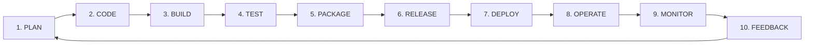
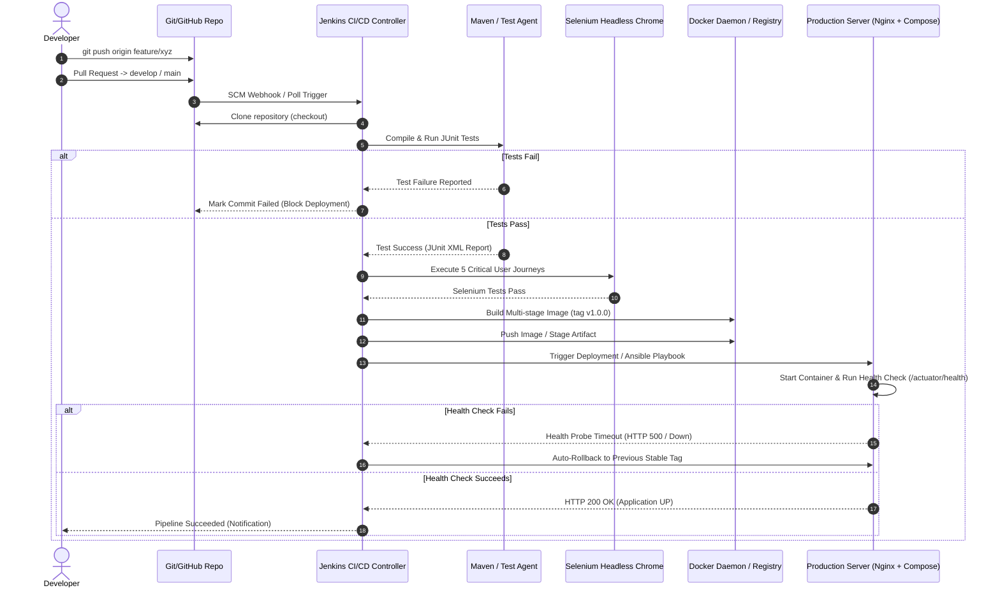
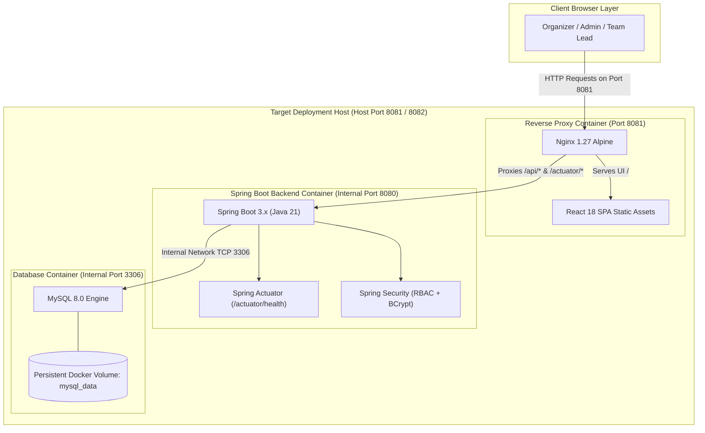

# DevOps Lifecycle & Continuous Workflow

**Project:** Dockerized Hackathon Team Management System  
**Framework:** Continuous Integration, Continuous Delivery & Reliability Engineering  

---

## 1. The 10-Phase DevOps Lifecycle

The project follows the standard closed-loop DevOps lifecycle:

### Detailed Lifecycle Phases
1. **PLAN:** Agile backlog grooming, Jira/Kanban task mapping, user stories with acceptance criteria, and 15-task scope freezing.
2. **CODE:** Modular Spring Boot 3.x backend, React/Vite component frontend, feature branching (`feature/*`), Git conventional commits, and peer code reviews.
3. **BUILD:** Maven compilation, dependency resolution, frontend bundle creation via Vite, and Docker multi-stage artifact extraction.
4. **TEST:** Comprehensive testing pyramid: JUnit 5 unit tests, Spring MockMvc API integration tests, and Selenium WebDriver browser automation for critical user journeys.
5. **PACKAGE:** Multi-stage Docker image creation (`Dockerfile`), layering Nginx reverse proxy with static assets, and packaging Spring Boot executable jar with pinned Java 21 runtime.
6. **RELEASE:** Semantic version tagging (`v1.0.0`), Docker image tagging (`hackathon-team-management-system:1.0.0` and `:latest`), and release artifact archiving.
7. **DEPLOY:** Automated zero-downtime deployment via Jenkins CD and Ansible configuration management playbooks on target hosts.
8. **OPERATE:** Containerized runtime orchestration via Docker Compose, isolated internal bridge networks, persistent database volumes, and non-root process security.
9. **MONITOR:** Continuous health probing via Spring Boot Actuator (`/actuator/health`), container status inspection, and Nginx access/error logging.
10. **FEEDBACK:** Automated deployment health verification, rollback trigger upon failed readiness probes, and test reporting back to developers.

---

## 2. CI/CD Pipeline Architecture & Flow

---

## 3. End-to-End System Deployment Topology

