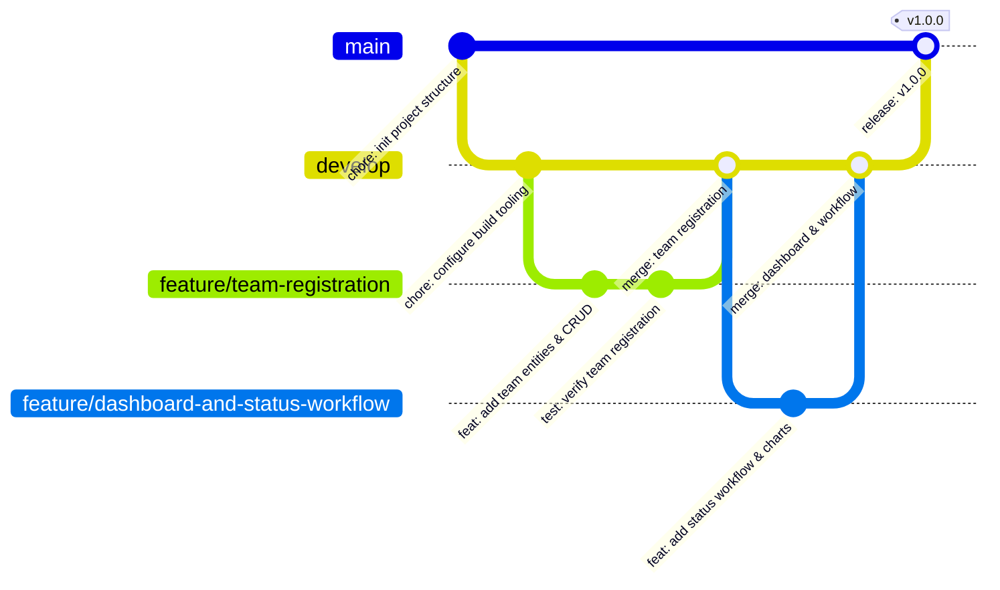

# Git Branching Strategy & Merge Conflict Resolution

**Project:** Dockerized Hackathon Team Management System  
**Version:** 1.0.0  
**Methodology:** GitFlow with Protected Trunk  

---

## 1. Branching Strategy

The repository adheres to a strict GitFlow-inspired branching strategy:



### Branch Definitions
* `main`: Production-ready, verified releases. Every commit to `main` is tagged with a semantic release version (e.g. `v1.0.0`).
* `develop`: Integration branch where features are combined and verified before release.
* `feature/*`: Dedicated branches for vertical feature development (e.g. `feature/team-registration`, `feature/dashboard-and-status-workflow`).
* `fix/*`: Targeted hotfixes for critical defects.
* `release/*`: Release candidate stabilization branches.

---

## 2. Merge Conflict Simulation & Resolution Demonstration

To demonstrate Git collaboration skills under an academic examination without corrupting the primary application code, a dedicated simulation branch was created.

### 2.1 The Scenario
Two developers concurrently modified the track configuration file `TrackConfig.java`:
* **Developer A (`feature/branch-a`):** Updated track names to include `ARTIFICIAL_INTELLIGENCE` and added metadata comments.
* **Developer B (`feature/branch-b`):** Concurrently updated the same file to add `MACHINE_LEARNING_OPS`.

### 2.2 The Conflict Encountered
When attempting to merge `feature/branch-b` into `develop` after `feature/branch-a` was already merged:
```text
CONFLICT (content): Merge conflict in TrackConfig.java
Automatic merge failed; fix conflicts and then commit the result.
```

### 2.3 Inspection of Conflict Markers
Git highlighted the colliding changes with standard conflict markers:
```text
<<<<<<< HEAD (develop)
    // Updated by Developer A
    AI_ML("Artificial Intelligence & Data Science"),
=======
    // Updated by Developer B
    AI_ML("Machine Learning & MLOps Infrastructure"),
>>>>>>> feature/branch-b
```

### 2.4 Resolution Process
1. **Identify the Intent:** Both developers intended to clarify the scope of the track.
2. **Harmonize Changes:** The conflict was resolved by merging both intents cleanly into a unified definition:
   ```java
   // Harmonized resolution combining AI and MLOps scope
   AI_ML("Artificial Intelligence, Machine Learning & MLOps"),
   ```
3. **Stage and Commit Resolution:**
   ```bash
   git add TrackConfig.java
   git commit -m "fix(merge): resolve conflict between TrackConfig branch A and B"
   ```
4. **Verification:** The application test suite (`mvn test`) was re-run to confirm zero compilation or logical regressions.

---

## 3. Remote GitHub Repository Setup Commands

If pushing this repository to a remote GitHub account:
```bash
# 1. Using GitHub CLI (if authenticated)
gh repo create hackathon-team-management-system --public --source=. --remote=origin --push

# 2. Or using standard Git remote commands
git remote add origin https://github.com/YOUR_USERNAME/hackathon-team-management-system.git
git push -u origin main
git push -u origin develop
git push --tags
```
